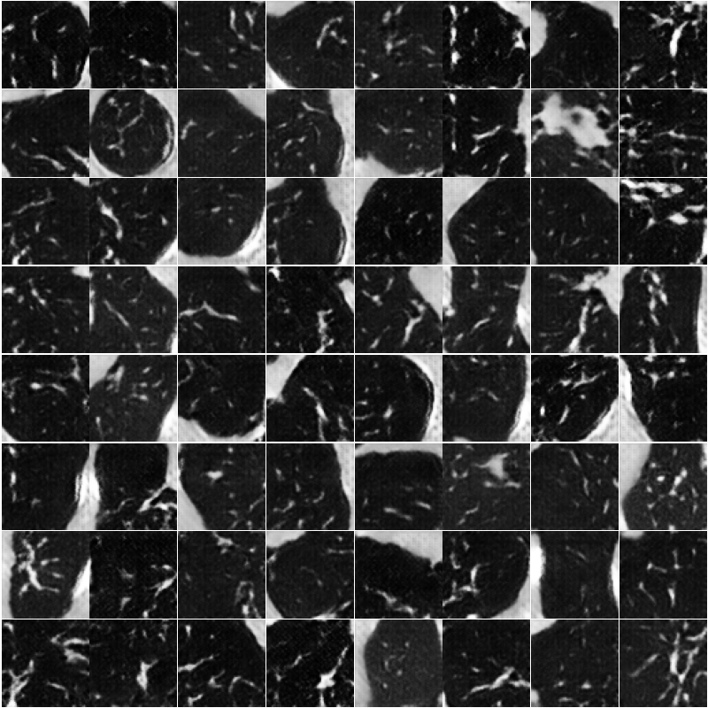

# CT patch synthesis with a DCGAN

A learning project exploring 64 × 64 grayscale CT patch synthesis with PyTorch and pydicom. The latest experiment uses a small LIDC-IDRI thoracic CT subset with patient-level separation. It is an exploratory pilot, with no clinical validation or demonstrated downstream benefit.

## Recorded experiments

| Experiment | Training data | Epochs | Final G loss | Final D loss |
| --- | --- | --- | --- | --- |
| Preserved single-image baseline | 50 overlapping patches from `CT_small.dcm` | 20 | approximately 10.45 | approximately 0.011 |
| LIDC-IDRI pilot v1 | 9,816 patches from 14 patients | 20 | 4.1086 | 0.4616 |

The baseline image shows the thoracic spine and surrounding structures. Its patches are not verified lung-nodule examples. Losses across these experiments are not directly comparable quality measures because the data, preprocessing and number of updates differ.



[Experiment report and limitations](experiments/lidc_v1/REPORT.md)

## Files

- `ct_preprocessing.py`: padding correction, rescaling, approximate in-plane resampling, heuristic lung masks and patch extraction.
- `prepare_patches.py`: replay saved slice manifests against locally obtained DICOM data.
- `models_dcgan.py`: generator and discriminator definitions.
- `train.py`: training, fixed-noise sample grids and checkpoints with optimizer and random-number states.
- `configs/patient_split_seed42.json`: recorded 14/3/3 patient split.
- `experiments/lidc_v1/session_record.ipynb`: archived session evidence. It contains historical cells and errors and is not a clean run-all notebook.
- `train_gan.ipynb`, existing `models/`, `patches/` and `results/`: legacy project artifacts. Existing weights are not the newly trained pilot checkpoint.

## Reproduce

Use Python 3.11 or later. Install a PyTorch build suitable for your hardware, then install the focused project dependencies:

```bash
pip install -r requirements.txt
```

Dependency ranges are supported targets, not the exact environment lock for the recorded Colab run. The old full Colab package list is preserved in `legacy/requirements_colab_original.txt`.

Obtain the CT data separately and retain the downloaded object manifest and source metadata. See [data provenance](docs/DATA.md). Replay the archived training slice selection:

```bash
python prepare_patches.py --dicom-root data/ct_dataset_20patients \
  --manifest data/training_slice_manifest.json --subset train \
  --out data/training_patches_v1
python train.py --patch-dir data/training_patches_v1 --out runs/lidc_v1 --epochs 20
```

Resume an interrupted run using the same patches and environment:

```bash
python train.py --patch-dir data/training_patches_v1 --out runs/lidc_v1 --epochs 20 --resume
```

A checkpoint saves each completed epoch. An interruption within an epoch requires repeating that epoch. Resume only trusted checkpoints, since they contain Python objects. Identical seeds do not guarantee identical results across hardware or software versions.

The original training slice manifest is stored with the experiment data in Google Drive and must be supplied to replay extraction. It is not embedded in this repository update. The original DICOM download and full pilot checkpoint are also stored separately. This limits independent reproduction until those provenance records and the exact environment are archived with a release.

## Data attribution

LIDC-IDRI is provided by The Cancer Imaging Archive under CC BY 3.0. Cite the collection and its publication when using the data. See [data sources and citations](docs/DATA.md). No clinical claims are made for generated patches.
