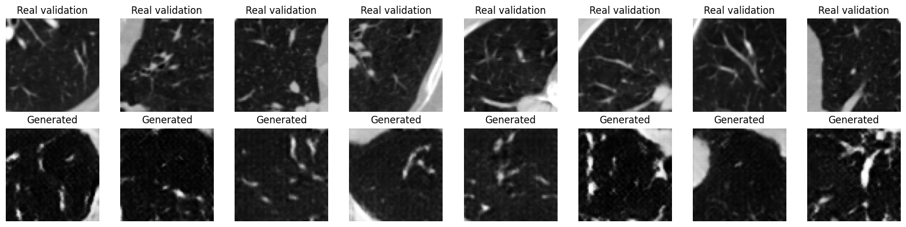

# LIDC-IDRI pilot v1, 14 October 2026

## Setup and observed results

The run used 14 training patients (9,816 patches), three validation patients (2,016 patches) and three reserved test patients. Training used a Tesla T4, seed 42, batch size 32, 20 epochs, latent dimension 100, Adam learning rate 0.0002 for both networks and betas (0.5, 0.999). The discriminator outputs logits and training uses BCEWithLogitsLoss. Each epoch contained 307 batches, approximately 6,140 discriminator and generator updates across the run.

Final epoch average losses were G 4.1086 and D 0.4616. The first epoch was run separately to verify saving, then the same in-memory run continued from epoch 2. An edited cell had a syntax/indentation failure before continuation, with no model update from that failed execution. This history is preserved in the archived notebook.

The figure shows independent real and generated examples using the same display range. Generated patches contain lung-like textures, bright branching patterns and boundary edges. Some details look blurred, thick or irregular. These are qualitative observations, not an anatomical validation. The original single-image baseline was described as gray/noise-like, but its images were not jointly evaluated here using a common metric.

## Evaluation completed

- Fixed-noise grids were saved after each epoch, with a constant intensity display range.
- Eight real validation patches were compared with eight generated patches.
- A separate seed (2026) produced 512 generated samples after training.
- Exploratory distributions of patch mean intensity, within-patch standard deviation and mean absolute adjacent-pixel gradient were compared with validation patches. The plots overlap but show differences in brightness spread and the high-gradient tail.

The latter evaluation files were generated after the archived notebook was downloaded. They remain in the Drive run folder and are not included in this update. The first downloaded results ZIP also predates those extra evaluation files. No numerical values beyond inspected training outputs are reported here.

## Limits

This is one run on a small convenience subset. Patch counts do not represent independent patients. Uniform patch sampling gives greater weight to patients with more retained slices. Training includes mixed original and derived scans. The mask heuristic and slice selection can introduce bias, and the training/validation selection preprocessing revisions differ.

No nearest-neighbor memorization check, formal perceptual quality metric, expert radiologist review, uncertainty analysis, repeat-seed experiment, held-out test evaluation or downstream task evaluation was completed. The basic statistics do not establish diversity, privacy protection or anatomical correctness. Neither the loss values nor these figures establish clinical validity, regulatory compliance or superiority over another model.

## Stored artifacts

The Colab run folder is `ct_gan_project/runs/dcgan_lidc_v1_20261014_174128` in Google Drive. It contains config, loss history, fixed noise, per-epoch figures and the latest checkpoint with model, optimizer and RNG states. The baseline ZIP and script were preserved separately on the user's computer. The checkpoint and DICOM data are not bundled into this repository update.
